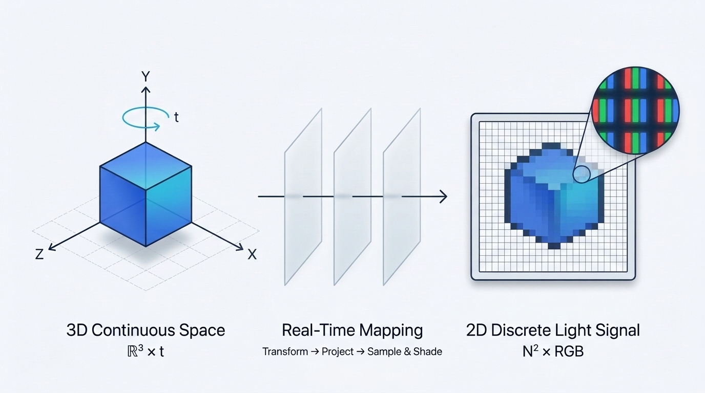
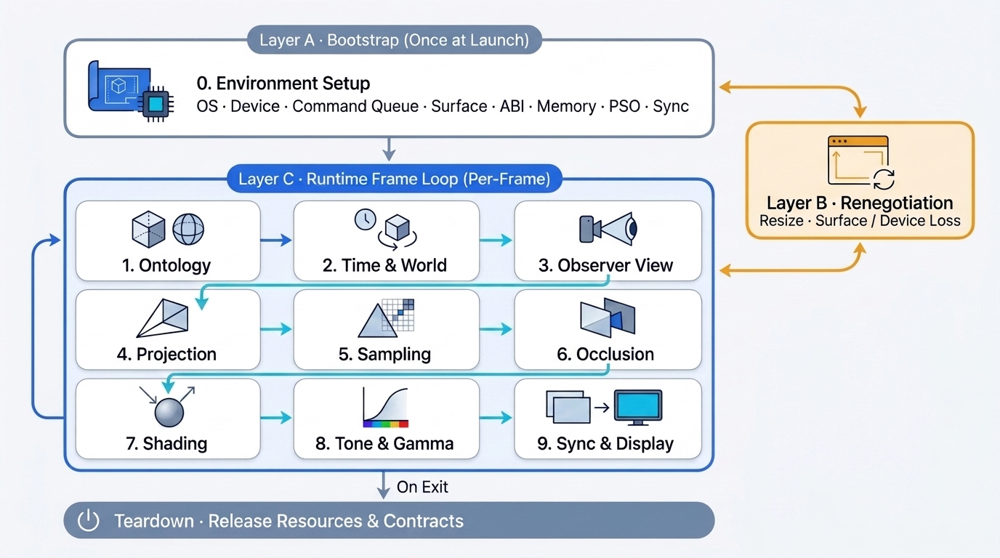

# 3D 가상 공간의 구축 및 런타임 시각화에 관한 의미론적(Semantic) 설계

## 1. 개요

본 문서는 특정 게임 엔진, 그래픽스 API(Vulkan, Metal, Direct3D 등), 혹은 렌더링 알고리즘(래스터라이제이션, 레이 트레이싱 등)에 종속되지 않고, **3D 가상 공간을 생성하여 런타임에 관찰자의 화면에 표시하는 프로그램이 갖추어야 할 필연적 과정**을 의미론적(Semantic) 관점에서 분석 및 설계한 문서입니다.

의미론적 본질에서 이 프로그램은 **'시간에 따라 변화하는 3차원 연속 공간의 수학적 상태 집합(R³ × t)'을 '2차원 이산 평면의 물리적 광신호(N² × RGB)'로 실시간 번역(Mapping)하는 인과적 변환 시스템**입니다.

이 변환이 실제 컴퓨터(CPU + GPU 이기종 시스템 + OS + 디스플레이) 위에서 작동하려면, **매 프레임 반복되는 논리적 변환(1–9단계)**에 앞서 기계와 운영체제 사이의 **실행 환경 사전 계약과 수명주기(0단계)**가 반드시 성립해야 합니다.

> **📌 NOTE:** 본 설계는 특정 API의 객체 구조가 아니라, 수학적·물리적·인지적·기계적 인과율에 의해 반드시 존재해야만 하는 논리적 계층과 단계들을 정의합니다.

---

## 2. 시간 축 계층과 전체 파이프라인 흐름

실시간 3D 프로그램의 작업은 실행 빈도와 변경 원인에 따라 **세 가지 시간 계층**으로 분리됩니다.

---

## 3. 실행 환경 구축과 수명주기 (0단계: Bootstrap, Renegotiation & Teardown)

### 3.1. 기계 입장에서 초기화가 필연적인 세 가지 근본 원인

수학적 변환(1–9단계)만 정의되어 있다고 해서 화면에 그림이 그려지지는 않습니다. 현대 컴퓨터 위에서 실시간 3D 렌더링을 실행하려면 아래 **세 가지 구조적 제약**을 반드시 해소해야 합니다.

1. **이기종성 (Heterogeneity)**: 제어와 시뮬레이션을 맡는 CPU와 대량 병렬 연산을 맡는 GPU는 명령어 집합(ISA), 컴파일러, 주소 공간, 물리 메모리, 실행 클럭 도메인이 서로 다릅니다. 따라서 장치 선정, 비동기 명령 채널, 메모리 배치, 데이터 ABI 규약을 사전에 합의해야 합니다.
2. **공유 자원의 중재 (OS Mediation)**: 물리 화면, GPU 연산 시간, 시스템 메모리는 단일 프로그램의 독점물이 아니라 운영체제(OS)가 여러 프로세스 사이에서 중재하는 공유 자원입니다. 따라서 OS 이벤트 루프, 디스플레이 출력 표면, 프로세스 간 보호·격리 경계를 공식 절차로 획득해야 합니다.
3. **비용 비대칭 (Cost Asymmetry)**: 셰이더 기계어 컴파일, 대규모 메모리 할당, 파이프라인 정합성 검증은 밀리초(ms) 단위의 고비용 작업입니다. 초당 60–120회 이상 반복되는 프레임 경로(8–16ms 예산)에서 이를 배제하려면 불변 조건을 미리 굳혀 두어야 합니다.

> **💡 NOTE — 왜 명시적 API(예: Vulkan)는 초기화만 수백 줄에 달하는가?**
>
> 명시적 API가 불필요한 의식을 추가한 것이 아닙니다. 위 **세 가지 근본 원인**에 다음 세 가지 특성이 곱해지기 때문입니다.
> - **암묵적 기본값 부재**: 모든 상태를 기본값으로 추측하지 않고 호출자가 명시적으로 선언해야 함.
> - **하드웨어 다양성(능력 질의)**: 수많은 GPU 벤더와 아키텍처의 지원 기능·메모리 힙·큐 구성을 런타임에 질의하고 선택해야 함.
> - **위험 추적(Hazard Tracking) 책임 위임**: 자원 간 읽기/쓰기 순서와 메모리 레이아웃 전환의 안전성 보장을 드라이버 자동화 대신 애플리케이션에 위임함.
>
> Metal/MetalKit이나 OpenGL 같은 고수준·반명시적 계층은 이 계약들을 없앤 것이 아니라, 드라이버와 프레임워크 내부에서 합리적 기본값으로 대행·은닉하고 있을 뿐입니다.

### 3.2. 초기화는 1회성이 아니다: 수명주기 (Bootstrap → Renegotiation → Teardown)

실행 환경 계약은 프로그램 시작 시 한 번 맺고 끝나는 정적 절차가 아닙니다. 런타임 중 창 크기 변경(Resize), 디스플레이 이동(색역·주사율 변화), 백그라운드 전환에 따른 표면 무효화, 혹은 GPU 리셋(Device Loss)이 발생하면 **영향받는 계약(특히 출력 표면·순환 버퍼·깊이 버퍼·종횡비)을 파기하고 다시 협상(Renegotiation)**해야 합니다. 프로그램 종료 시에는 진행 중인 GPU 작업의 완료를 대기한 뒤 모든 자원과 OS 계약을 역순으로 해제(Teardown)합니다.

### 3.3. 기계가 체결해야 하는 8가지 사전 계약

| 영역 | 근본 원인 | 기계적 필연성과 계약 내용 |
| :--- | :--- | :--- |
| **0.1. OS 프로세스·이벤트 루프·프레임 클럭** | 공유 자원 중재 | OS로부터 앱 활성화 권한, 입력 이벤트 채널(`Input`), 고정밀 시간원(`Δt`), 디스플레이 주사율에 맞춘 프레임 콜백을 확보합니다. 이 계약 없이는 2단계의 시간 전이와 상호작용이 성립하지 않습니다. |
| **0.2. 연산 주체 탐색 및 논리적 점유** | 이기종성 · 다양성 | 시스템 내 물리 GPU의 능력(정밀도, 기능 집합, 화면 출력 가능 여부)을 평가·선정하고, 드라이버와 통신할 논리적 실행 세션(Device/Context)을 획득합니다. |
| **0.3. 비동기 명령 채널 개설** | 이기종성 | CPU와 GPU는 독립 클럭으로 동작하므로 CPU가 GPU 레지스터를 직접 제어할 수 없습니다. 메모리 기반 명령을 일괄 제출할 단방향 큐(Command Queue)와 명령 기록용 메모리를 확보하며, 하드웨어에 따라 그래픽스·연산·전송·표출 전용 엔진을 구분해 배정합니다. |
| **0.4. OS 디스플레이 표면 결합 및 출력 순환** | 공유 자원 중재 | GPU가 그린 픽셀 배열은 메모리 조각일 뿐이며 물리 화면의 소유권은 OS 윈도우 컴포지터에 있습니다. 창(Window)과 GPU가 공유할 표면(Surface)을 연결하고, 해상도·색 공간·비트 깊이·순환 버퍼 수·주사 동기화 정책을 합의합니다(창 크기 변경 시 재협상 대상). |
| **0.5. CPU↔GPU 데이터 ABI 계약** | 이기종성 | 서로 다른 컴파일러로 빌드된 두 프로세서가 같은 바이트 열을 같은 의미로 해석해야 합니다. 구조체 정렬(Alignment), 패딩, 정점 속성 오프셋과 스트라이드 등 바이너리 인터페이스를 엄격히 일치시킵니다. |
| **0.6. 메모리 토폴로지 정렬 및 자원 실체화** | 이기종성 · 비용 비대칭 | 정점·인덱스·프레임 상수·깊이 버퍼를 하드웨어 메모리 특성에 맞게 할당합니다. 분리된 VRAM(PCIe 경유) 환경에서는 스테이징(Staging) 전송 계약이 필요하고, 통합 메모리(Unified Memory) 환경에서는 공유 저장소로 단순화되는 등 토폴로지에 따라 계약 형태가 달라집니다. |
| **0.7. 불변 실행 상태 사전 컴파일** | 비용 비대칭 · 이기종성 | 셰이더 코드를 대상 GPU의 기계어(ISA)로 번역하고, 하드웨어가 셰이더 마이크로코드와 결합해 고정해야 하는 상태(출력 포맷, 블렌딩, 정점 페치 등)를 불변 파이프라인 객체(PSO)로 사전 확정합니다. 반면 뷰포트·시저처럼 저렴하게 바꿀 수 있는 상태는 동적 상태로 분리하며, 컬링 모드·와인딩 등 어느 상태까지 동적으로 허용하는지는 API마다 경계가 다릅니다. |
| **0.8. 동기화 원시체 구축 및 위험 추적 경계** | 이기종성 · 비용 비대칭 | 비동기 CPU↔GPU 간 완료 대기와 자원 재사용을 제어할 동기화 객체(펜스, 세마포어)를 사전 생성합니다. 또한 GPU 내부 파이프라인 단계 간 메모리 의존성(배리어, 레이아웃 전환)은 매 프레임 명령에 기록되며, 이 위험 추적(Hazard Tracking)을 드라이버가 자동화할지 앱이 명시할지가 API 설계의 핵심 경계가 됩니다. |

---

## 4. 기준 좌표계의 상대성 사슬 (Relativity of Reference Frames)

3차원 데이터가 화면의 화소로 도달하기 위해서는 관점(기준점)의 연속적인 전이(Change of Basis)가 선행되어야 합니다.

| 순서 | 좌표계 명칭 | 기준점 (Origin) | 의미론적 목적 |
| :--- | :--- | :--- | :--- |
| **1** | **개체 고유 공간 (Local Space)** | 개별 개체의 중심점 | 개체 고유의 기하학적 형태를 외부 환경과 무관하게 독립 정의 |
| **2** | **세계 공간 (World Space)** | 가상 세계의 절대 원점 | 독립된 개체들을 단일 공유 공간에 배치하여 상호 위치 관계 확립 |
| **3** | **관찰자 공간 (View Space)** | 관찰자(카메라)의 위치 | 세계의 모든 요소를 관찰자의 시선과 위치를 기준으로 재정렬 |
| **4** | **동차 절단 공간 (Clip Space)** | 투영 행렬 적용 직후의 동차 좌표계(원근 투영 시 일반적으로 `w ≠ 1`, 직교 투영은 `w = 1` 유지) | 원근 나눗셈(`/w`) 이전에 `w ≤ 0`(카메라 뒤쪽) 기하와 시야 절두체 경계를 안전하게 절단(Clipping) |
| **5** | **정규화 투영 공간 (NDC)** | 시야 절두체의 정규화 기준점 | 원근 나눗셈(`/w`)을 거쳐 시야 절두체를 규격화된 직육면체로 압축 (예: Metal·Direct3D·Vulkan은 `xy ∈ [-1, 1]`, `z ∈ [0, 1]`; OpenGL은 `xyz ∈ [-1, 1]`) |
| **6** | **화면 공간 (Screen Space)** | 디스플레이 좌상단/좌하단 | 뷰포트 변환(Viewport Transform)과 깊이 범위 매핑을 거쳐 정규화 좌표를 실제 출력 장치의 이산 화소(Pixel) 격자와 깊이 값에 대응 |

> **📌 NOTE — 동차 절단 공간(Clip Space)과 법선(Normal) 변환 규칙:**
> - **Clip Space의 필연성**: 원근 투영에서 `w`는 관찰자로부터의 깊이에 비례합니다. 카메라 평면이나 뒤쪽에 위치한 점(`w ≤ 0`)에 바로 `/w`를 수행하면 0으로 나누기 또는 부호 반전이 발생하므로, 절두체 절단(Clipping)은 반드시 NDC 이전의 동차 절단 공간에서 이루어져야 합니다.
> - **법선 벡터의 공변 변환**: 위치 벡터는 모델 행렬(`M`)로 직접 변환되지만, 표면에 수직인 법선 벡터(Normal)는 공변 벡터(Covariant Vector)이므로 비균등 스케일(Non-uniform Scale)이 포함된 일반 변환에서는 `M`의 상위 3×3 **역전치 행렬(`transpose(inverse(M))`)**로 변환해야 직교성이 보존됩니다. (순수 회전·균등 스케일만 존재할 때에 한해 정규화 전제 시 `M`의 직접 적용과 방향이 일치합니다.)

---

## 5. 런타임 단계별 의미론적 과정 및 필연적 이유

### 5.1. 공간과 개체의 존재론적 정의 (Spatial Ontology & State Representation)
- **일어나는 과정**:
  - 가상 공간의 기저(Basis)와 차원을 규정합니다.
  - 공간 내에 존재할 개체의 기하학적 형상(Geometry), 표면의 물리적·광학적 반응 특성(Material), 에너지를 방출하는 광원(Light Source)을 개체 고유 공간(Local Space)의 수학적 데이터로 정의합니다.
  - 변하지 않는 정적 에셋은 0단계(정적 계약)에서 미리 적재되며, 런타임 중 동적으로 생성·소멸되는 개체는 2단계의 상태 전이와 결합해 관리됩니다.
- **필연적 이유**:
  - 물리적 실체가 없는 가상 세계를 연산하려면, 무엇보다 먼저 "무엇이 어떤 형태와 물성으로 존재하는가"에 대한 데이터적 실체화(Ontological Definition)가 전제되어야 합니다. 형태가 없으면 공간을 점유할 수 없고, 물성이 없으면 빛과의 상호작용을 정의할 수 없습니다.

### 5.2. 시간의 진행과 상태 전이 (Temporal State Transition & World Placement)
- **일어나는 과정**:
  - 0단계에서 확보한 시간원(`Δt`)과 외부 자극(`Input`, 시스템 이벤트)에 따라 개체들의 상태를 갱신하고, 고유 공간의 개체들을 세계 공간(World Space)에 배치(이동, 회전, 크기 변환)합니다.
  - 물리 법칙 적용, 형태 변형(애니메이션), 개체의 동적 생성 및 소멸이 이 단계에서 확정됩니다.
- **필연적 이유**:
  - '런타임(Runtime)'이란 정지된 박제가 아니라 시간 축 위에서 인과율이 작동하는 동적 상태를 의미합니다. 시간에 따른 상태 전이 함수 `S(t + Δt) = f(S(t), Δt, Input)`가 없다면 가상 공간의 운동성과 상호작용성은 성립할 수 없습니다.

### 5.3. 관찰자의 정립과 시점 변환 (Observer Specification & View Transformation)
- **일어나는 과정**:
  - 가상 세계를 바라보는 관찰자(센서/카메라)의 위치, 응시 방향, 상방 기준(Up Vector), 시야각(FOV)을 규정합니다.
  - 절대적인 세계 공간(World Space)의 모든 좌표를 관찰자 중심의 상대 좌표계(View Space)로 변환합니다.
- **필연적 이유**:
  - 가상 공간 데이터 자체는 객관적일지라도, "화면에 보인다"는 현상은 언제나 **특정 관찰 주체의 시각적 주관성**을 전제로 합니다. 어디에서 어디를 바라보는지 정의되지 않으면 공간의 어떤 단면을 추출해야 할지 결정할 수 없습니다.

### 5.4. 가시 영역 선별과 사영 변환 (Visibility Culling, Clipping & Projection)
- **일어나는 과정**:
  - **시야 절두체 선별(Frustum Culling)**: 관찰자의 유한한 시야 범위 밖에 완전히 벗어난 개체를 조기에 배제합니다.
  - **사영 변환(Projection)**: 3차원 관찰자 공간의 기하를 동차 절단 공간(Clip Space)으로 사영하되, 전후 판별을 위한 깊이(Depth) 척도를 보존합니다(깊이를 유지하는 3D→3D 사영 변환이며, 실제 2D 평면 격자로의 축소는 5단계 이산화에서 완성됩니다).
  - **경계 절단(Clipping) 및 원근 분할**: 동차 절단 공간에서 절두체 경계(`w ≤ 0` 포함)에 걸친 기하를 잘라낸 뒤 원근 나눗셈(`/w`)으로 NDC로 정규화합니다.
  - **후면 제거(Back-face Culling, 4–5단계 경계)**: 닫힌 불투명 입체에서 관찰자 반대편을 향하는 면은 투영 후 화면 공간의 정점 감기 순서(Winding)로 판별하여 이산화 직전에 배제합니다.
- **필연적 이유**:
  - 유한한 컴퓨팅 자원으로 실시간성을 달성하려면 보이지 않는 기하를 조기에 차단해야 하며, 원근감을 반영해 시야 절두체를 정규화 공간으로 사영해야 후속 이산화와 깊이 비교가 일관된 척도 위에서 수행될 수 있습니다.

> **📌 NOTE — 4–6단계의 알고리즘 비종속적 본질(가시성 질의):**
> 4–6단계의 공통된 의미론적 목적은 **"각 화면 화소(시선 방향)에 어떤 표면이 보이는가"를 판별하는 가시성 질의(Visibility Query)**입니다.
> - **래스터라이제이션(객체 순서, Object-Order)**: 개체들을 먼저 투영(4) → 화소 격자로 이산화(5) → 깊이 버퍼 비교로 폐색 해결(6)하는 순서로 루프를 돕니다.
> - **레이 트레이싱(이미지 순서, Image-Order)**: 2D 센서 격자에서 광선을 먼저 표본화(5) → 3D 공간의 기하와 교차 검사하여 NDC 기반 래스터 경로 없이 가시 표면과 폐색을 동시에 확정(4·6)하는 역순으로 작동합니다.

### 5.5. 공간의 이산화와 표본화 (Spatial Discretization & Sampling)
- **일어나는 과정**:
  - 연속적인(Continuous) 투영 평면의 기하 정보를 디스플레이의 물리적 최소 단위인 이산적(Discrete) 화소 격자(Pixel Grid) 위치에서 표본화(Sampling)하고, 정점의 법선·물성 등의 속성을 표면 내부 지점으로 원근 보정 보간(Perspective-correct Interpolation)합니다.
  - 연속 신호를 이산 격자로 변환할 때 발생하는 고주파 왜곡(계단 현상, Aliasing)을 완화하기 위해 다중 표본화(MSAA) 또는 필터링을 수행합니다.
- **필연적 이유**:
  - 수학적으로 정의된 공간과 도형은 무한한 정밀도를 가진 연속체이지만, 디지털 화면은 유한한 개수의 점(Pixel)으로 이루어진 이산 집합입니다. 연속 함수를 이산 신호로 변환하는 표본화 과정 없이는 디지털 메모리에 화면을 기록할 수 없습니다.

### 5.6. 폐색 해결과 가시 표면 확정 (Occlusion Resolution & Surface Determination)
- **일어나는 과정**:
  - 동일한 화소(시선 방향)에 여러 **불투명(Opaque)** 개체의 표면이 겹쳐 투영될 때, 관찰자로부터의 깊이(거리)를 비교하여 가장 앞선 표면만을 가시 표면으로 확정하고 가려진(Occluded) 표면을 기각합니다.
  - **반투명(Transparency) 예외**: 빛을 투과시키는 반투명 표면이나 볼류메트릭 매질은 단일 표면 기각이 성립하지 않으므로, 일반적으로 깊이 순서대로 정렬하거나 순서 독립 기법(OIT)을 사용해 선형 색 공간에서 여러 표면의 광학 기여를 누적(Blending)해야 합니다.
- **필연적 이유**:
  - 불투명한 물체들이 중첩되었을 때 뒤쪽 물체가 앞쪽 물체를 뚫고 보인다면 3차원 공간의 원근 인과율이 파괴됩니다. 또한, 최종적으로 눈에 보이지도 않을 피폐색 표면에 대해 고비용의 광학 연산을 수행하는 모순을 방지하기 위해 가시 표면의 확정이 선행(또는 결합)되어야 합니다.

### 5.7. 광학적 상호작용 해석 (Optical Evaluation & Radiance Integration)
- **일어나는 과정**:
  - 확정된 가시 표면 지점에서, 광원으로부터 입사된 빛 에너지가 표면의 물성(반사율, 거칠기, 굴절률 등) 및 기하학적 법선(Normal) 방향과 상호작용하여 관찰자의 시선 방향으로 방출되는 최종 선형 복사휘도(Linear Radiance)와 파장 분포를 계산합니다.
- **필연적 이유**:
  - 시각이란 물체 그 자체를 만지는 것이 아니라, 물체 표면과 상호작용하여 눈으로 들어온 빛(광자 에너지)을 감지하는 과정입니다. 기하학적 투영과 이산화만으로는 평면적인 실루엣만 얻을 수 있을 뿐이며, 광학적 에너지 평가가 이루어져야만 입체적인 음영(Shading), 재질감, 공간감이 완성됩니다.

### 5.8. 인지적 색 공간 매핑 및 양자화 (Perceptual Tone Mapping & Quantization)
- **일어나는 과정**:
  - **동적 범위 압축**: 물리적으로 계산된 선형(Linear) 빛 에너지(이론상 `0 ~ ∞`의 HDR 범위)를 디스플레이 장치가 출력할 수 있는 유한한 휘도 범위로 압축(Tone Mapping)합니다. 별도의 HDR 톤매핑을 두지 않는 단순 LDR 파이프라인에서는 출력 범위 `[0, 1]`로의 클램프(Clamp)로 대체됩니다.
  - **선형 공간 블렌딩 우선**: 반투명 합성과 같은 색상 블렌딩은 반드시 비선형 감마 인코딩 이전의 **선형(Linear) 색 공간**에서 수행되어야 물리적 빛의 가산 법칙이 보존됩니다.
  - **감마 인코딩 및 양자화**: 인간 시지각의 비선형적 밝기 인지 특성과 디스플레이의 색역(Color Gamut) 규격에 맞추어 색 공간을 변환(예: sRGB 감마 인코딩, 하드웨어 `_sRGB` 렌더 타겟에서 저장 시점 자동 수행 가능)한 뒤, 정해진 비트 깊이(예: 채널당 8비트/10비트)의 이산 정수 값으로 양자화(Quantization)합니다.
- **필연적 이유**:
  - 가상 공간에서 계산된 물리적 빛의 강도는 제한이 없으나, 실제 모니터 소자가 낼 수 있는 최대 밝기와 표현 가능한 색상 수는 유한합니다. 물리적 에너지 영역을 하드웨어 규격 및 인간 시각 인지 영역으로 번역하지 않으면 밝은 영역의 정보 소실(Clipping)이나 감마 왜곡이 발생합니다.

### 5.9. 시간적 격리 동기화 및 물리적 신호 표출 (Temporal Synchronization & Signal Transduction)
- **일어나는 과정**:
  - 시간적 격리는 서로 다른 두 경계에서 독립적으로 작동합니다.
    1. **CPU↔GPU 프레임 자원 격리 (In-flight Frame Isolation)**: CPU가 `N+1`번째 프레임의 상태(Uniform 등)를 기록하는 동안 GPU가 `N`번째 프레임을 동시에 소비할 수 있도록 프레임 자원 슬롯을 복수(예: 2–3개)로 분리하고 세마포어/펜스로 경합을 차단합니다.
    2. **GPU↔Display 출력 버퍼 격리 (Presentation / Swapchain Buffering)**: 현재 렌더링 중인 후면 버퍼(Back Buffer)와 화면에 주사 중인 전면 버퍼(Front Buffer)를 격리하고, 디스플레이 주사 주기(Refresh Rate)에 맞추어 원자적으로 교체(Swap/Presentation)합니다.
  - 완성된 2차원 디지털 색상 배열을 디스플레이 컨트롤러가 전기 신호로 변환하여, 패널의 발광 소자(OLED, LCD 등)가 물리적 광자(Photon)를 관찰자의 눈을 향해 방출합니다.
- **필연적 이유**:
  - **데이터 경합 및 화면 찢어짐 방지**: CPU↔GPU 격리가 없으면 GPU가 읽는 중인 상태 버퍼를 CPU가 덮어쓰는 경쟁 상태(Race Condition)가 발생하며, GPU↔Display 격리가 없으면 한 화면 안에 과거 시점과 현재 시점이 상하로 찢어져 공존하는 시간적 인과율 붕괴(Screen Tearing)가 일어납니다.
  - **처리량과 입력 지연(Input Latency)의 트레이드오프**: In-flight 슬롯 깊이와 스왑체인(드로어블) 버퍼 수를 늘리면 CPU-GPU 파이프라인 병렬성(처리량)과 프레임 안정성은 높아지지만, 2단계에서 수집한 사용자 입력(`Input`)이 실제 광자로 표출되기까지의 지연 시간(Latency)이 증가합니다. 따라서 두 격리 계층의 깊이는 실시간 상호작용 루프 전체를 닫는 설계 변수입니다.
  - **물리적 변환(Transduction)**: 최종적으로 메모리 내의 추상적 비트열이 물리적 빛 에너지로 전환되어야만 비로소 인간의 감각 기관이 가상 공간을 "화면에 보이는 실체"로 지각하게 됩니다.
